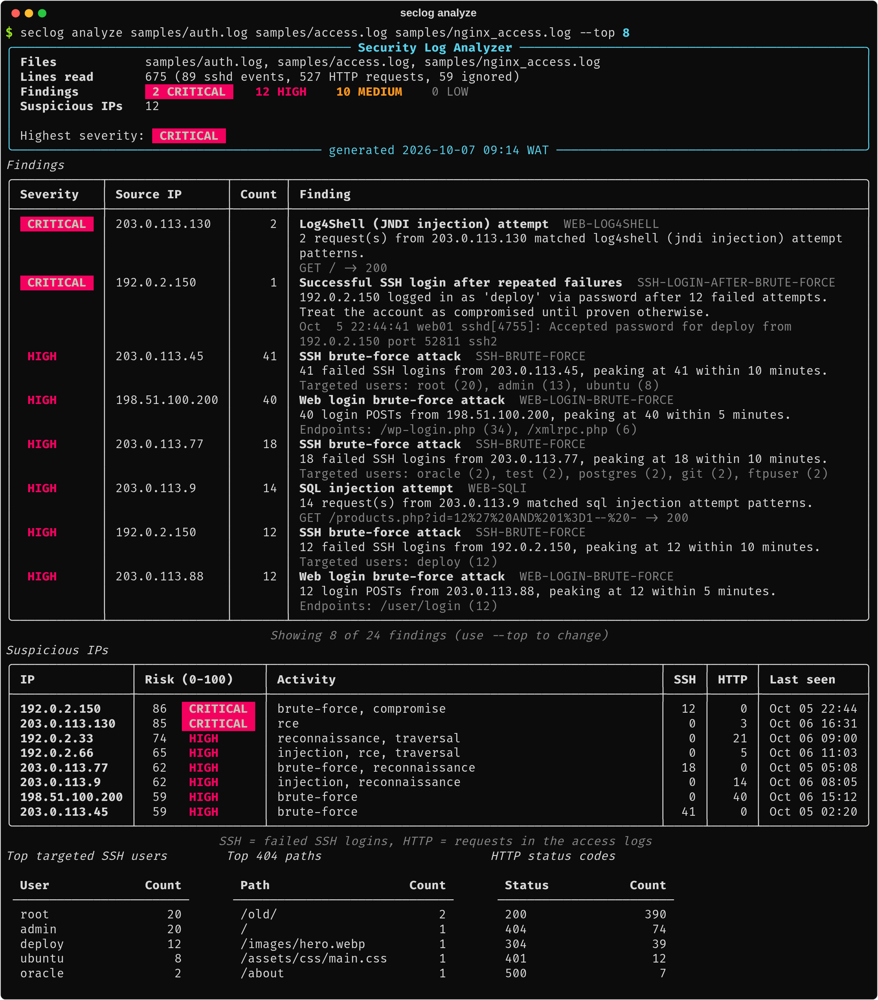
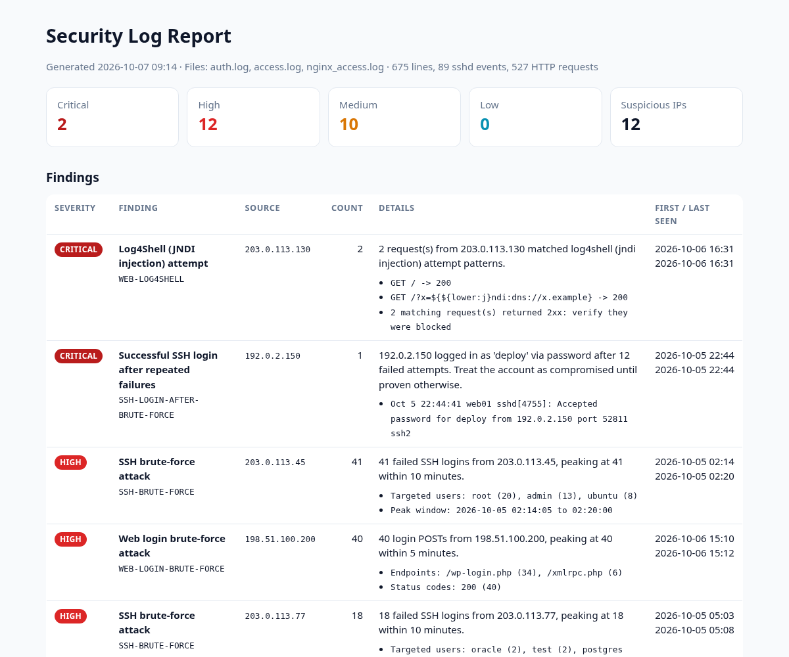

# 🛡️ Security Log Analyzer

A fast, dependency-light **Python CLI that reads Linux auth logs and Apache/Nginx access
logs and tells you who is attacking your server**: SSH brute force (and the scary case
where it succeeded), username enumeration, web login brute force, 404 scanning bursts,
known scanner tools, and SQL injection, XSS, path traversal, command injection, Log4Shell
and Shellshock payloads.

Results are shown as a colour-coded terminal report and can be exported to **JSON**,
**CSV** and a **standalone HTML** report.




---

## ✨ Features

**Log parsing**

- `sshd` entries from `/var/log/auth.log` (Debian/Ubuntu) and `/var/log/secure` (RHEL),
  with classic syslog (`Oct  5 02:14:05`) or RFC 3339 (`2026-10-07T08:12:01+01:00`)
  timestamps.
- Apache and Nginx access logs in **Combined** or **Common** Log Format, IPv4 and IPv6.
- Automatic format detection per file, transparent `.gz` support, and tolerance of
  garbage lines (for example TLS handshakes sent to a plain-HTTP port).

**Detection rules** (run `seclog rules` to list them)

| Rule | Severity | What it catches |
| ---- | -------- | --------------- |
| `SSH-BRUTE-FORCE` | high | ≥ N failed logins from one IP inside a sliding window |
| `SSH-LOGIN-AFTER-BRUTE-FORCE` | critical | a successful login from an IP that was brute-forcing |
| `SSH-USER-ENUMERATION` | medium | one IP trying many non-existent usernames |
| `SSH-DISTRIBUTED-ATTACK` | medium | one account attacked from many IPs (low-and-slow) |
| `SSH-ROOT-LOGIN` | medium | direct root login over SSH (policy) |
| `WEB-LOGIN-BRUTE-FORCE` | high | bursts of POSTs to `wp-login.php`, `xmlrpc.php`, `/login`, ... |
| `WEB-404-SCAN` | medium/high | bursts of 404s from one IP (directory brute-forcing) |
| `WEB-SCANNER-UA` | medium | sqlmap, Nikto, Nmap, Gobuster, Nuclei, WPScan, ffuf, ... |
| `WEB-SQLI` | high | `UNION SELECT`, tautologies, `SLEEP()`, `information_schema`, stacked queries |
| `WEB-XSS` | high | `<script>`, event handlers, `javascript:` URLs, `document.cookie` |
| `WEB-PATH-TRAVERSAL` | high | `../`, `/etc/passwd`, `php://filter`, `win.ini` |
| `WEB-COMMAND-INJECTION` | high | `;cat`, `$(whoami)`, backticks, `cmd=...wget` |
| `WEB-LOG4SHELL` | critical | `${jndi:...}` in URL, User-Agent or Referer, including obfuscated forms |
| `WEB-SHELLSHOCK` | high | `() { :; };` in headers |
| `WEB-SENSITIVE-FILE` | medium | `.env`, `.git/`, SQL dumps, backups, phpMyAdmin, `server-status` |

URLs are decoded up to three times before matching, so double-encoded payloads such as
`%253Cscript%253E` are still caught. When a matching request returned **2xx**, the
finding says so, because that is the one to check first.

**Reporting**

- **Suspicious IPs** ranked by a 0-100 threat score (worst finding + breadth + volume),
  labelled public / private / loopback / documentation.
- Summary tables: most targeted SSH users, top 404 paths, HTTP status codes.
- `--json`, `--csv` and `--html` exports. CSV cells that start with `=`, `+`, `-` or `@`
  are neutralised to prevent spreadsheet formula injection; all HTML output is escaped.
- `--fail-on high` makes the exit code usable in cron jobs or CI.



## 🛠 Tech Stack

| Area | Choice |
| ---- | ------ |
| Language | Python 3.10+ (fully type-annotated, `py.typed`) |
| Terminal UI | [Rich](https://github.com/Textualize/rich) |
| CLI | `argparse` with an installable `seclog` entry point |
| Packaging | `pyproject.toml` (setuptools) |
| Tests | pytest + pytest-cov |
| Quality | Ruff (lint + format), mypy `--strict` |

The only runtime dependency is `rich`.

## 📁 Project Structure

```
security-log-analyzer/
├── src/seclog/
│   ├── cli.py                # seclog analyze / seclog rules
│   ├── analyzer.py           # runs detectors, scores IPs, builds the Report
│   ├── models.py             # AuthEvent, AccessEvent, Finding, Severity
│   ├── parsers/
│   │   ├── auth.py           # sshd / syslog parser
│   │   ├── access.py         # Apache & Nginx access log parser
│   │   └── __init__.py       # format detection, gzip, load_logs()
│   ├── detectors/
│   │   ├── bruteforce.py     # SSH + web login brute force, enumeration, root login
│   │   ├── web_attacks.py    # SQLi / XSS / traversal / RCE / sensitive file signatures
│   │   ├── scanning.py       # 404 bursts and scanner user agents
│   │   ├── windows.py        # sliding-window helper
│   │   └── config.py         # Thresholds
│   └── reports/              # terminal (Rich), JSON, CSV, HTML
├── samples/                  # realistic sample logs (documentation IP ranges only)
├── scripts/generate_samples.py
├── docs/                     # screenshots and example JSON / CSV / HTML reports
└── tests/                    # 115 pytest tests
```

## 🚀 Getting Started

```bash
git clone https://github.com/Josephobaje/security-log-analyzer.git
cd security-log-analyzer
python -m venv .venv
source .venv/bin/activate          # Windows: .venv\Scripts\activate
pip install -e ".[dev]"
```

Try it on the bundled samples:

```bash
seclog analyze samples/auth.log samples/access.log samples/nginx_access.log --year 2026
```

## 📖 Usage

```bash
# Analyse live logs (needs read access, usually root or the adm group)
sudo seclog analyze /var/log/auth.log /var/log/nginx/access.log

# Rotated and compressed logs work too
seclog analyze /var/log/auth.log.1 /var/log/apache2/access.log.2.gz

# Export reports
seclog analyze samples/*.log --year 2026 \
  --json reports/report.json --csv reports/findings.csv --html reports/report.html

# Only show high and critical findings, quietly, and fail a cron job if any exist
seclog analyze /var/log/auth.log --min-severity high --quiet --fail-on high

# Tune thresholds for a busy server
seclog analyze access.log --scan-404s 50 --scan-window 2 --login-attempts 30

# List all rules
seclog rules
```

| Option | Description |
| ------ | ----------- |
| `-f, --format {auto,auth,access}` | force a log format (default: detect per file) |
| `--year YEAR` | year for syslog timestamps, which do not include one (default: current) |
| `--json / --csv / --html PATH` | write reports |
| `--min-severity LEVEL` | hide findings below `info`, `low`, `medium`, `high` or `critical` |
| `--fail-on LEVEL` | exit with status `1` if any finding is at or above LEVEL |
| `--top N` | rows per table in the terminal report |
| `-q, --quiet` / `--no-color` | silence the terminal report / disable colours |
| `--ssh-failures`, `--ssh-window` | SSH brute-force threshold and window (minutes) |
| `--user-enum` | distinct invalid usernames per IP |
| `--scan-404s`, `--scan-window` | 404 burst threshold and window |
| `--login-attempts`, `--login-window` | web login brute-force threshold and window |

Exit codes: `0` success, `1` findings at or above `--fail-on`, `2` input or usage error.

Example outputs generated from the samples are in
[`docs/examples/`](docs/examples): [`report.json`](docs/examples/report.json),
[`findings.csv`](docs/examples/findings.csv) and [`report.html`](docs/examples/report.html).

## 🧪 Tests and Quality

```bash
pytest --cov=seclog     # 115 tests, ~97% coverage
ruff check .            # lint
ruff format --check .   # formatting
mypy                    # strict type checking
```

The tests cover every parser variant, threshold boundaries for each rate-based rule,
positive **and negative** (false-positive) cases for the attack signatures, IP scoring,
HTML escaping, CSV formula-injection protection, and the CLI end to end.

## ⚠️ Limitations

- Signature matching is heuristic. It will not catch every obfuscated payload and can
  occasionally flag an unusual but legitimate URL. Always verify before blocking.
- Request bodies are not in access logs, so POST payloads cannot be inspected.
- Classic syslog lines have no year or time zone: pass `--year` for older logs; times are
  interpreted in the machine's local time zone.

## 🗺 Roadmap

- [ ] `journalctl -o json` input and `fail2ban` log support
- [ ] GeoIP / ASN enrichment (offline MaxMind database)
- [ ] Generate `iptables` / `nftables` / `fail2ban` block lists from findings
- [ ] Watch mode (`tail -f`) with alerts to email or Slack
- [ ] Custom rules from a YAML file

## 📄 License

Released under the [MIT License](LICENSE). © 2026 Joseph Obaje.

## 👤 Author

**Joseph Obaje**: Full Stack Developer and cybersecurity enthusiast (Python, PHP,
Flutter, WordPress, SEO).

- GitHub: [@Josephobaje](https://github.com/Josephobaje)
- LinkedIn: [joseph-obaje](https://www.linkedin.com/in/joseph-obaje)

Use this tool only on systems and logs you are authorised to analyse.
